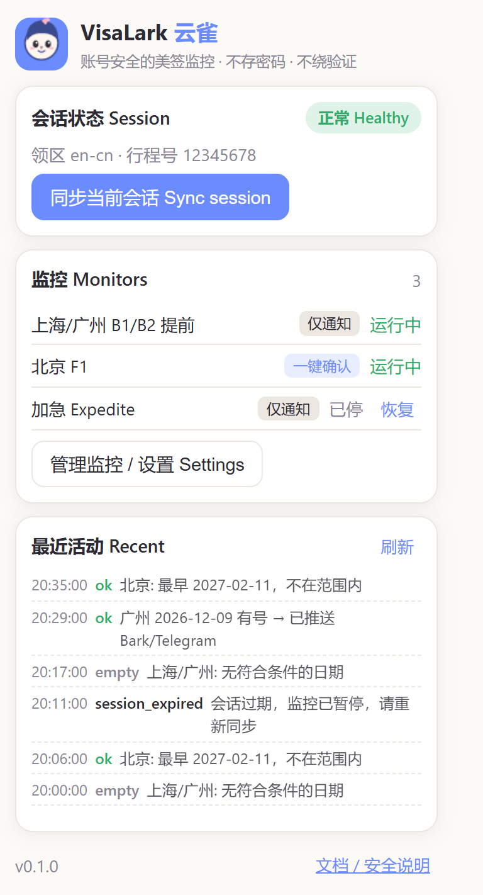
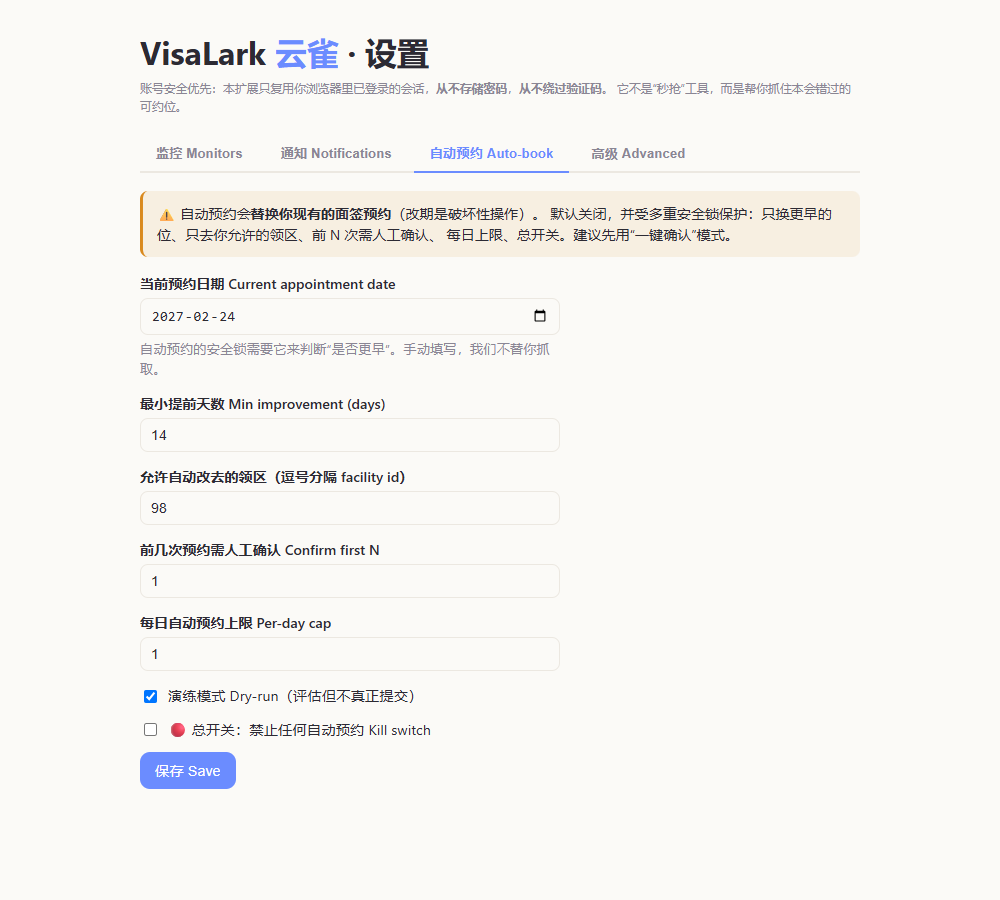

# VisaLark

[](https://github.com/appleweiping/visa-lark/actions/workflows/ci.yml) · [中文说明](README.zh.md)

VisaLark checks the US visa appointment calendar on `ais.usvisa-info.com` from your own logged-in browser and pings your phone (Bark, ServerChan/WeChat, Telegram or a webhook) when an earlier date opens at a consulate you would accept.

> [!WARNING]
> **Read before using.** Automated access to the appointment site may break its terms of service, and the site can restrict accounts it considers automated. You use VisaLark at your own risk. It only reuses the session you logged into yourself, never stores your password, does not solve CAPTCHAs or rotate proxies, and stops as soon as the site challenges it. Automatic rescheduling is **off by default**, replaces your existing appointment when it fires, and has not been verified end to end against real accounts.

| Extension popup | Auto-reschedule settings (off unless you choose the "auto" mode) |
|---|---|
|  |  |

Both screenshots are the built extension rendered with made-up data (no real account involved).

## Why I built it

Moving a US visa interview earlier usually means refreshing the scheduling page for days, especially at the consulates in China. The scripts I found either run on a cloud server or ask for your password, and both made me nervous about the visa account itself. I wanted something that does the boring part, checking every few minutes at a slow, jittered pace from the browser I already logged into, and tells my phone when a date worth taking shows up.

It will not win slots that disappear within seconds of being released, and it does not try to: that requires the proxy pools and evasion this project leaves out on purpose.

## What it does

- **Watches several consulates at once** and reports the earliest date that fits your filters (date window, weekdays, time of day). The expedite calendar can be watched too.
- **Notifies** through Bark (iOS), ServerChan (WeChat), Telegram, a generic webhook and the browser's own notifications.
- **Three modes per monitor:** `notify` (default) only alerts; `confirm` puts a button in the alert that opens a confirmation page, and you click to reschedule; `auto` reschedules on its own, behind the checks below.
- **Backs off on trouble.** An expired session (401, redirect to sign-in) or a challenge page (403, CAPTCHA) pauses the monitor and alerts you; rate limiting (429, Cloudflare error 1015) triggers a long back-off. It never tries to get past any of them.

### Safety checks in the code

- Polling profiles of about 5, 3 or 1.5 minutes with ±40–50% jitter, plus a per-account daily request cap (`packages/shared/src/safety.ts`).
- The local agent looks up its public IP's network and refuses to start on a cloud/datacenter network unless you override it (`apps/agent/src/ip-guard.ts`). A login from home followed by requests from a datacenter is a common account-takeover signal, so the part that talks to the site should run where you logged in.
- `auto` mode only books when the new date is earlier by at least N days, at a consulate you allow-listed, after the first N bookings were confirmed by hand, within a per-day cap, with a kill switch and a dry-run mode (`packages/shared/src/interlocks.ts`). If the site's response is unclear the attempt is marked failed and you are asked to check manually.

## Install

### Browser extension (recommended)

1. Download `visalark-extension-<version>.zip` from [Releases](https://github.com/appleweiping/visa-lark/releases) (built by CI from the tagged commit) and unzip it, or build it yourself:
   ```bash
   pnpm install
   pnpm build:packages
   pnpm --filter @visa-lark/extension build      # output: apps/extension/dist
   ```
2. Open `chrome://extensions` (or `edge://extensions`), enable Developer mode, click **Load unpacked** and choose the folder.
3. Log in to `ais.usvisa-info.com` yourself and open the reschedule page.
4. Click the VisaLark icon → **Sync session**. It reads the consulate and schedule id from the page URL.
5. In Settings, add a monitor (consulates, visa type, date window, mode) and at least one notification channel.

### Local agent (runs without a browser open)

For a home PC or Raspberry Pi, not a cloud server:

```bash
pnpm install && pnpm build:packages && pnpm --filter @visa-lark/agent build
cp apps/agent/visalark.config.example.json apps/agent/visalark.config.json
# paste the _yatri_session cookie from your logged-in browser, consulate, schedule id and channels
node apps/agent/dist/index.js apps/agent/visalark.config.json
```

### Optional control plane

`apps/control-plane` is a small Fastify + SQLite service that keeps a history of seen dates (and a heatmap of when slots tend to appear) and can relay notifications. It never receives visa credentials. See [apps/control-plane/README.md](apps/control-plane/README.md).

## Repository layout

```
packages/shared               scheduling, safety limits, auto-book checks, shared types
packages/adapter-usvisa-info  the only code that talks to the visa site
packages/notify               Bark, ServerChan, Telegram and webhook channels
apps/extension                Manifest V3 extension (vanilla TypeScript + Vite)
apps/agent                    local Node agent with the residential-IP check
apps/control-plane            optional history / relay service
apps/web                      landing page and mock demo, deployed at visa-lark.vercel.app
```

[DESIGN.md](DESIGN.md) has the threat model and the reasoning behind these choices.

## Development

```bash
pnpm install
pnpm build:packages                          # the apps import the built packages
pnpm -r --filter "!@visa-lark/web" test      # vitest in every package and app
```

CI runs the same steps, builds the extension and uploads the zip as an artifact, and typechecks, lints and builds `apps/web`; pushing a `v*` tag publishes the extension zip as a GitHub release.

## Disclaimer

VisaLark is a personal, non-commercial project and is not affiliated with CGI Federal or the U.S. Department of State. It does not provide a hosted service, holds nobody's credentials and cannot promise you an appointment. Nothing here is legal advice.

Copyright 2026 Weiping Yan. Licensed under [Apache-2.0](LICENSE); see also [NOTICE](NOTICE).
